# Astral Vigil

*The Watchers guard the firmament. A rift in the sky rains star fragments upon the world – and the Eclipse awakens.*

**Catch falling stars. Bend starlight. Build the gates to the sky – and face the Watchers in their trials.**

Astral Vigil is a NeoForge progression mod about starlight. It starts with a meteor crashing into your world on a clear
night and ends far above the clouds in the **Firmament**: a floating sky dimension of trial islands that you can only
reach through gates you build yourself. Guarded by four towering Watchers, and haunted by their fallen fifth sibling,
the Eclipse.

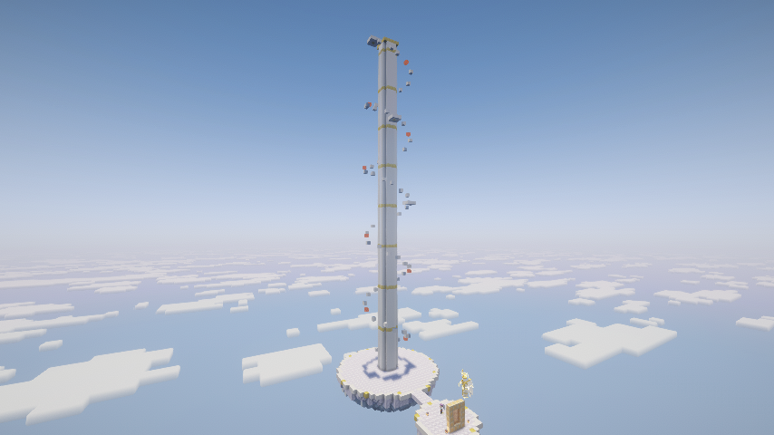

| Minecraft | Loader | Java | Requires | Status |
|---|---|---|---|---|
| 1.21.1 | NeoForge 21.1.266+ | 21 | GeckoLib 4.9+ | feature complete, pre-release |
| 26.1.2 | NeoForge 26.1.2.126+ | 25 | GeckoLib 5.5+ | feature complete, pre-release |

[Deutsch weiter unten](#deutsch) · [Changelog](docs/CHANGELOG.md) · [Roadmap](docs/ROADMAP.md) ·
[Balance](docs/BALANCE.md) · [Design decisions](docs/DECISIONS.md)

## Why Astral Vigil?

- **The night sky matters.** Starlight depends on the time, the moon phase, the weather and an open sky. Stars
  literally fall: meteors carve craters and leave Fallen Stars to mine.
- **Light you can see.** Collectors, Lenses, Mirrors, Prisms and Reservoirs throw visible beams across your base.
  Starlight is pushed, not polled: a whole network costs a fraction of a millisecond per tick.
- **Rituals with rules.** Convergence rituals reward symmetry and aligned blocks. Get sloppy and they turn unstable:
  offerings fly and something answers.
- **Gear that grows with you.** Six pieces of living gear awaken through your deeds, take socketed Sigils and unlock
  starlight-powered abilities. Top tier is on par with Netherite, never above it.
- **A dimension you have to earn.** Six kinds of gates, each one built and lit by hand, each leading to its own
  challenge: a hundred-block climb, an archery trial under attack, a puzzle of light, a lightless library maze – and
  the throne of the Eclipse.
- **Made for modpacks.** Every balance value is in the server config, every recipe uses `c:` tags, worldgen is a
  datapack. Optional JEI, EMI, Jade, Patchouli and KubeJS support. Built with All the Mods 10 and 11 in mind.
- **Fully playable in English and German.**

## Gallery

*Shown with Complementary Reimagined.*

| | |
|---|---|
| 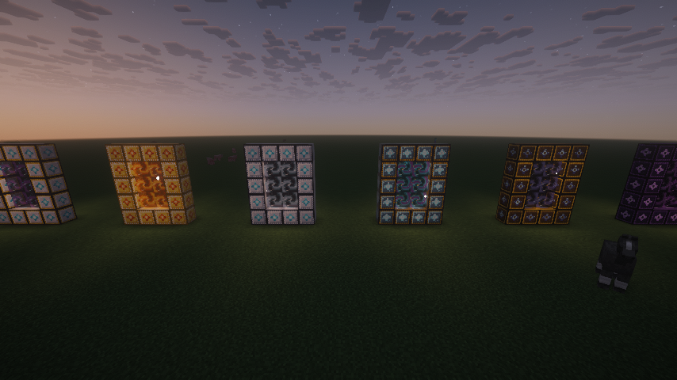 | 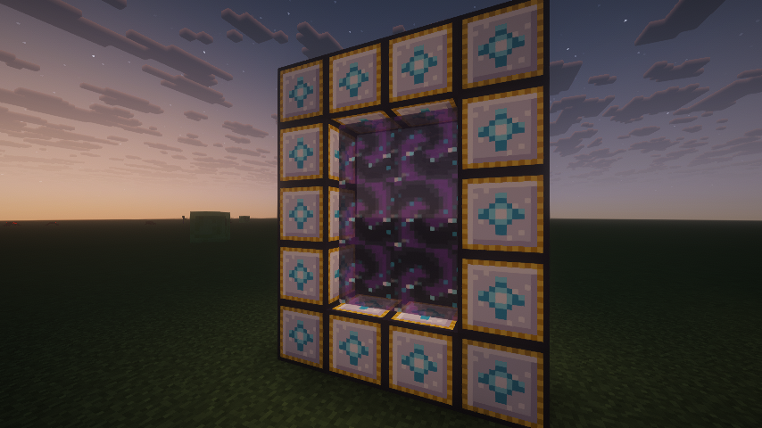 |
| 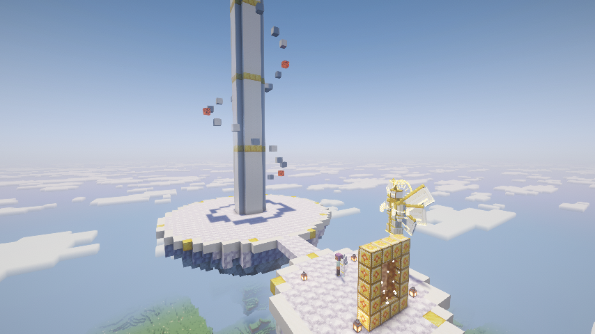 | 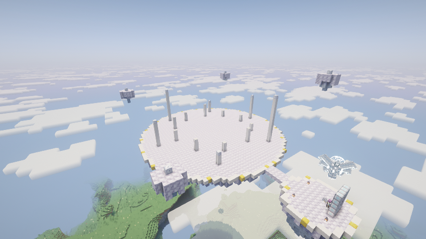 |
| 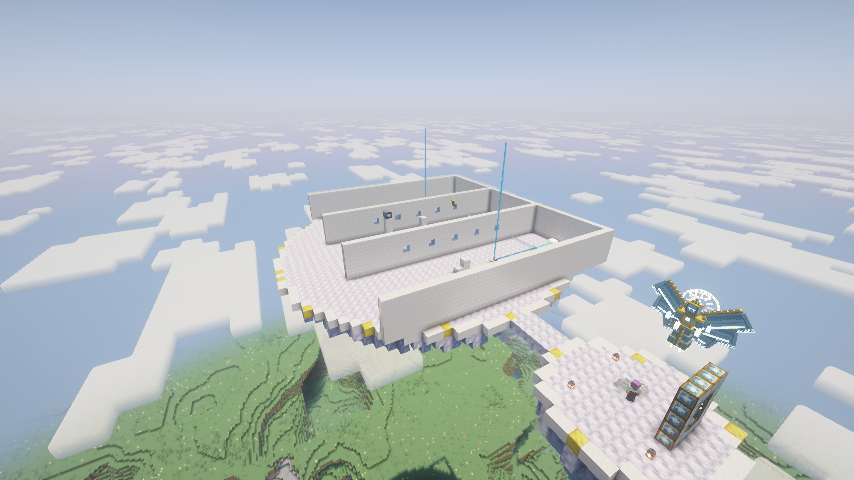 | 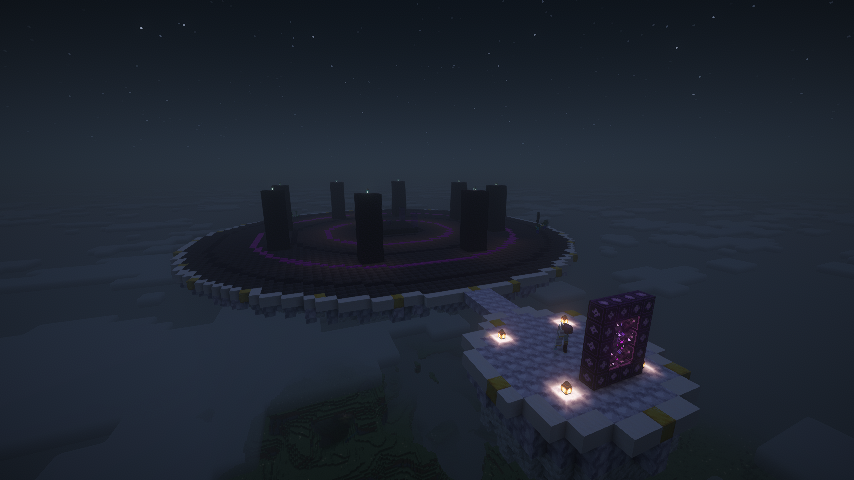 |
| 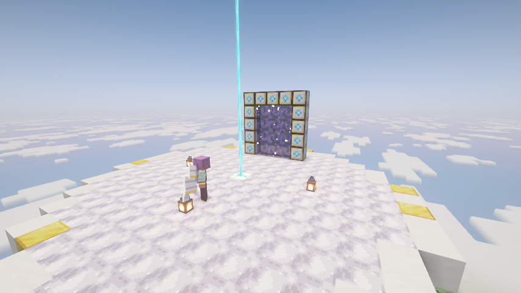 | 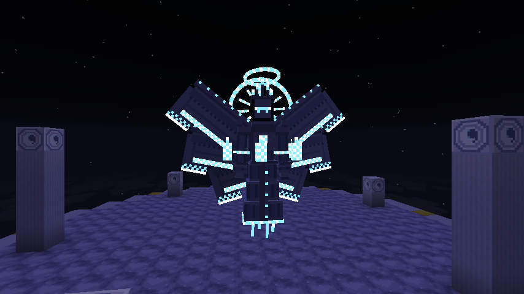 |
| 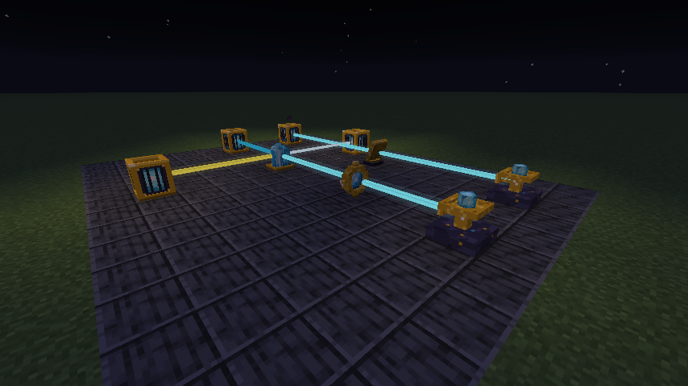 | 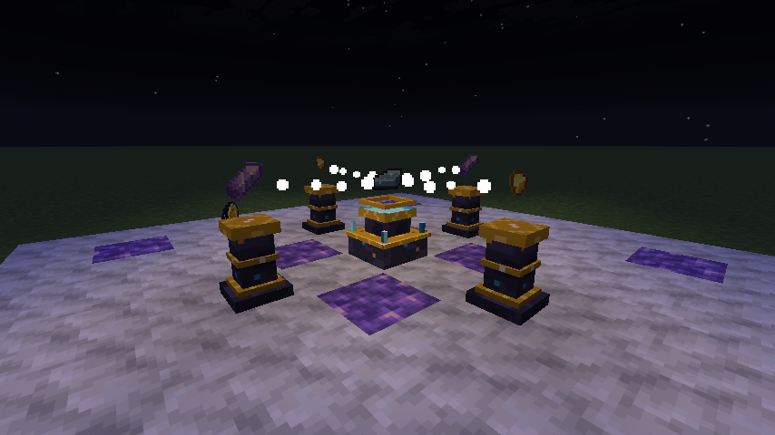 |
| 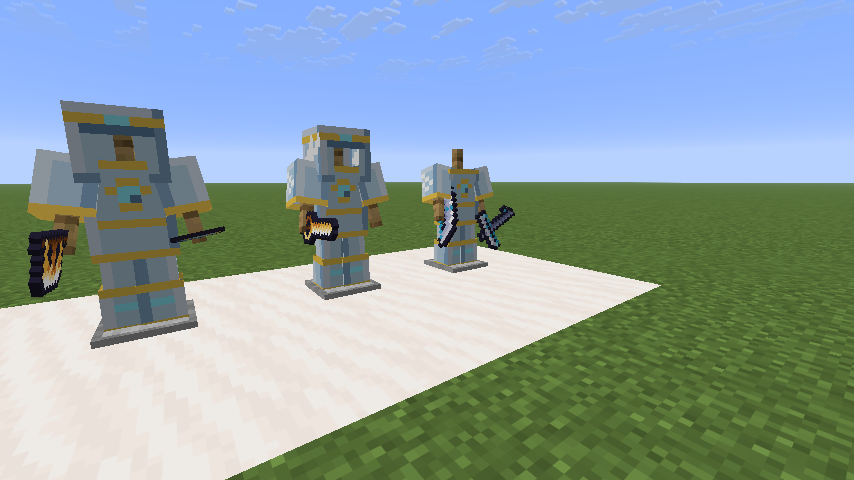 | 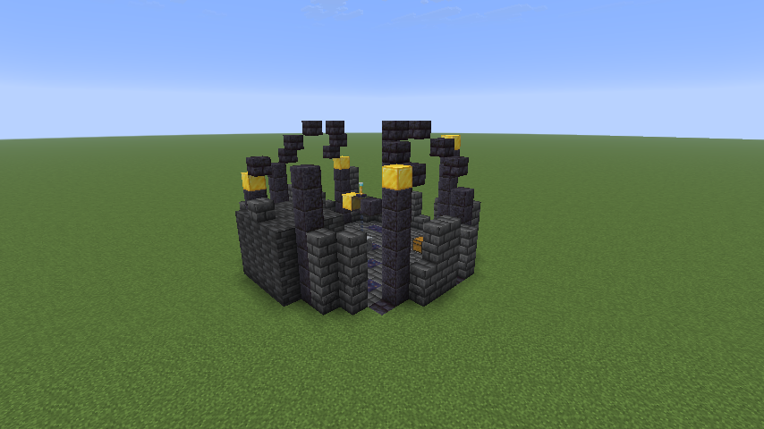 |

More in [`docs/screenshots/`](docs/screenshots/).

## The journey

1. **Starfall.** On clear nights, fragments of the sky crash into the world. Mine the Fallen Star for Astral Shards
   and craft an **Astrolabe**: it reads the sky, the moon phase and the starlight where you stand, and tracks fallen
   stars.
2. **Research.** Study blocks of the four alignments – *Sol*, *Luna*, *Stella* and *Void* – and connect the
   constellations on the **Star Chart**. The **Codex Caelestis** records what you learn.
3. **Starlight.** Collectors gather light under the open night sky. Guide it with Lenses and Mirrors, split it into
   Sol, Luna and Stella with a Prism and store it in Reservoirs.
4. **Convergence.** Rituals at the **Convergence Altar** and the **Astral Forge** turn offerings and starlight into
   Starmetal, Sunsteel and Moonsilver.
5. **Living gear.** Halo Edge, Dawnbreaker, Crescent, Tidecaller, Starlight Aegis and Seraph Plate awaken through
   deeds, take **Sigils** and unleash abilities that cost starlight.
6. **The world.** Explore **Fallen Observatories**, open their Constellation Locks, collect the 24 pages of the Lost
   Chronicle and hold **Star Anchor** rituals – while the **Eclipse Gaze** grows with every use of celestial power.
7. **The gates.** Forge the **Ascension Key**, build a gate frame and set the key into it. The frame decides where it
   leads:

   | Gate | Leads to | The challenge |
   |---|---|---|
   | Astral Gate | the Firmament hub | low gravity, floating islands, the sky above the clouds |
   | Solar Gate | Solenne's **Sun Spire** | a 100-block climb on single pads; gold pads are checkpoints, magma burns |
   | Lunar Gate | Vael's **Moon Arena** | ten moon targets, four on distant islets, while Eclipse Echoes keep rising |
   | Prism Gate | Orrin's **Prism Observatory** | three halls of mirrors; all three receptors must glow at once |
   | Archive Gate | Ilyra's **Endless Library** | a dark, roofed maze, 70 × 70 blocks |
   | Umbral Gate | the **Umbral Throne** | opens only for one who carries all four Watchers' Marks |

8. **The Watchers.** Solenne, Vael, Orrin and Ilyra – floating six-winged seraphs, three times your size – wait beside
   their trials. Each trial earns a **Mark** and the Watcher's favour, and cools its rival.
9. **The Eclipse.** On the Umbral Throne, an **Umbral Sigil** calls down the fallen fifth Watcher: a three-phase boss
   with telegraphed Void Lances, Echo waves and Umbral Novas you can only survive behind cover. Its heart becomes the
   **Halo of Dawn**; its feathers bind **Seraph Wings** to you.

## Compatibility

Optional integrations, none required: **JEI** and **EMI** (ritual recipes), **Jade** (starlight, rituals,
Watchers), **Patchouli** (Codex Caelestis), **KubeJS** and datapacks (all recipes are data-driven with `c:` and
`astralvigil:` tag inputs). Runs alongside Sodium, Iris, Curios and the Apotheosis family. Designed for All the Mods 10
(1.21.1) and All the Mods 11 (26.1).

## Configuration

- `astralvigil-server.toml` – every balance value: starfall, astrolabe, research, the starlight network, crafting,
  gear, Eclipse Gaze, rituals and the Eclipse fight. The reasoning is in [docs/BALANCE.md](docs/BALANCE.md).
- `astralvigil-client.toml` – particles, screen shake, beam quality.
- Worldgen is a datapack: override `data/astralvigil/worldgen/structure_set/fallen_observatory.json` to retune or
  disable observatories.
- Admin commands: `/astralvigil starfall [here]`, `/astralvigil research <alignment> <points>|reset`,
  `/astralvigil starlight <pos> <tint> <amount>`.

## Building

Requires Temurin JDK 21 and 25. One codebase for both Minecraft versions (Stonecutter + ModDevGradle).

```powershell
.\gradlew.bat build               # both targets + unit tests
.\gradlew.bat runGameTestServer   # all GameTests, both targets
.\gradlew.bat runData             # regenerate models, lang, recipes, loot, advancements, codex
```

Jars land in `versions/<target>/build/libs/`. Contributor notes: [CLAUDE.md](CLAUDE.md).

## License

All Rights Reserved for now – the final license is pending.

---

## Deutsch

*Die Wächter hüten das Firmament. Ein Riss im Himmel lässt Sternensplitter auf die Welt regnen – und die Finsternis
erwacht.*

**Fang fallende Sterne. Lenke Sternenlicht. Baue die Tore zum Himmel – und stelle dich den Prüfungen der Wächter.**

Astral Vigil ist ein Fortschritts-Mod für NeoForge rund um Sternenlicht. Er beginnt mit einem Meteor, der in einer
klaren Nacht in deine Welt stürzt, und endet hoch über den Wolken im **Firmament**: einer schwebenden
Himmelsdimension voller Prüfungsinseln, die du nur durch selbst gebaute Tore erreichst. Behütet von vier
gewaltigen Wächtern – und heimgesucht von ihrem gefallenen fünften Geschwister, der Finsternis. Für Minecraft 1.21.1
und 26.1.2, vollständig auf Deutsch spielbar.

### Was dich erwartet

- **Der Nachthimmel zählt.** Sternenlicht hängt von Uhrzeit, Mondphase, Wetter und freiem Himmel ab. Sterne fallen
  wirklich: Meteore reißen Krater und hinterlassen Gefallene Sterne.
- **Sichtbares Licht.** Sammler, Linsen, Spiegel, Prismen und Speicher werfen sichtbare Strahlen durch deine Basis –
  und kosten dabei kaum Leistung.
- **Rituale mit Regeln.** Konvergenzrituale belohnen Symmetrie und ausgerichtete Blöcke. Wer schlampt, erlebt ein
  instabiles Ritual.
- **Ausrüstung, die mitwächst.** Sechs lebendige Ausrüstungsteile erwachen durch deine Taten, nehmen Siegel auf und
  entfesseln Fähigkeiten. Höchste Stufe ≈ Netherit, nie darüber.
- **Eine Dimension, die man sich verdient.** Sechs Torarten, jede von Hand gebaut und entzündet, jede mit eigenem
  Ziel: ein Aufstieg über hundert Blöcke, eine Bogenprüfung unter Beschuss, ein Rätsel aus Licht, ein lichtloses
  Bibliothekslabyrinth – und der Thron der Finsternis.
- **Für Modpacks gebaut.** Alle Balancewerte in der Serverkonfiguration, alle Rezepte mit `c:`-Tags, Weltgenerierung
  als Datapack; optional JEI, EMI, Jade, Patchouli und KubeJS.

### Die Tore

| Tor | Führt zu | Die Herausforderung |
|---|---|---|
| Astraltor | Mitte des Firmaments | geringe Schwerkraft, schwebende Inseln über den Wolken |
| Sonnentor | Solennes **Sonnenspitze** | 100 Blöcke Aufstieg auf einzelnen Stufen; goldene Stufen sind Rastpunkte |
| Mondtor | Vaels **Mondarena** | zehn Mondzielscheiben, vier davon auf fernen Inselchen, während Echos angreifen |
| Prismentor | Orrins **Prismenobservatorium** | drei Spiegelhallen; alle drei Empfänger müssen zugleich leuchten |
| Archivtor | Ilyras **Endlose Bibliothek** | ein dunkles, überdachtes Labyrinth, 70 × 70 Blöcke |
| Umbraltor | der **Umbralthron** | öffnet sich nur dem, der alle vier Zeichen der Wächter trägt |

Auf dem Umbralthron ruft ein **Umbrales Siegel** die Finsternis herab: ein Bosskampf in drei Phasen. Ihr Herz wird
zum **Heiligenschein der Morgenröte**, ihre Federn binden dir **Seraphsflügel**.

### Lizenz

Vorerst alle Rechte vorbehalten – die endgültige Lizenz steht noch aus.
