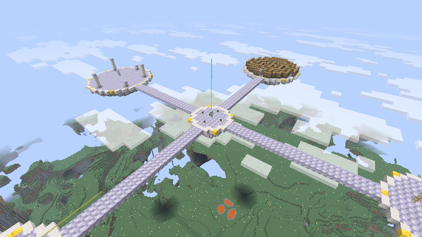
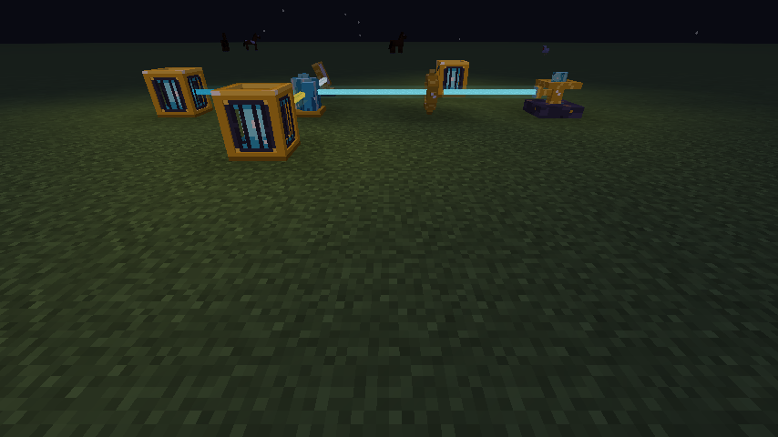
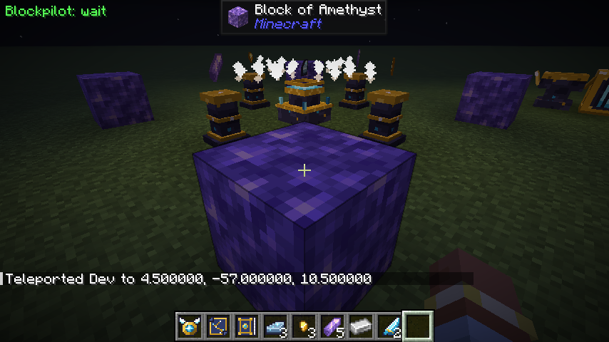
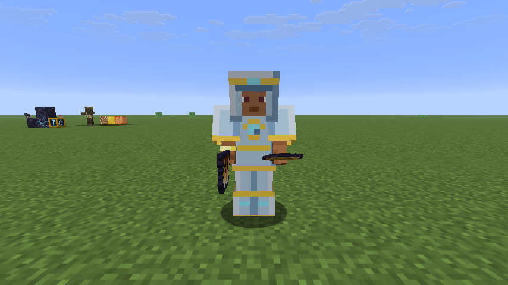
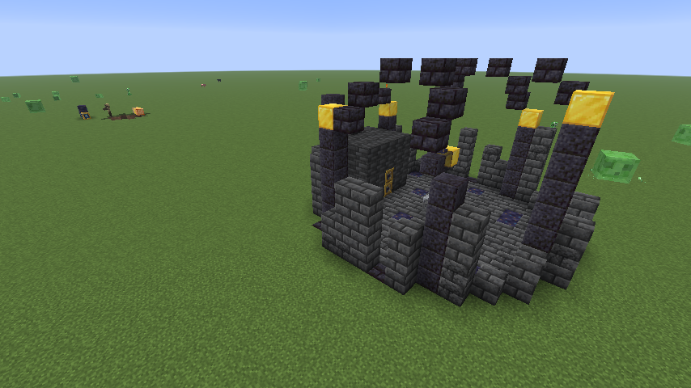
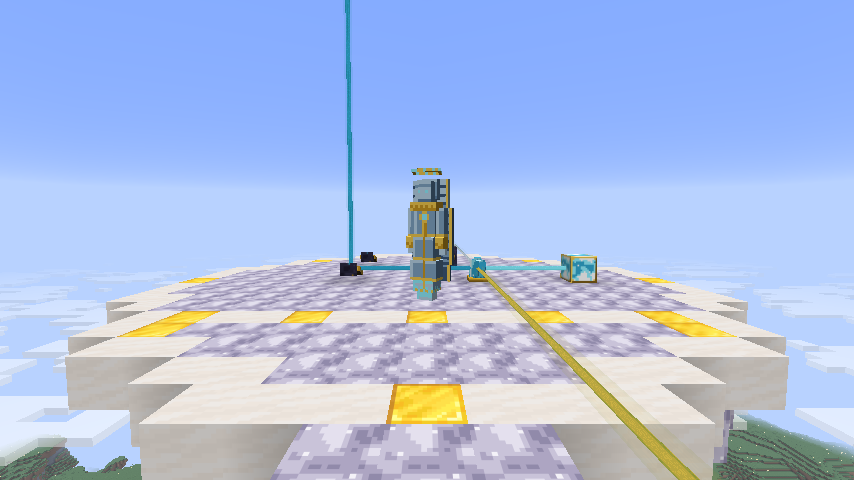
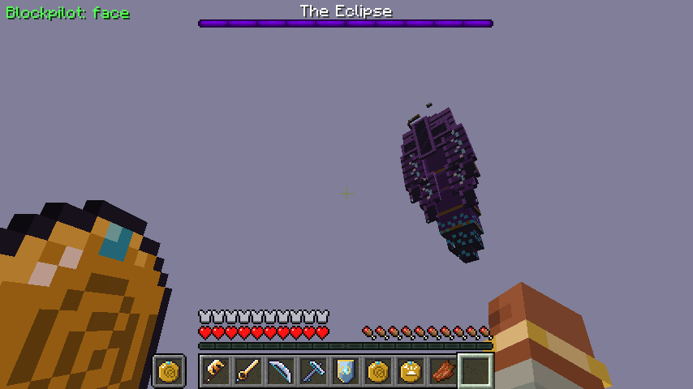
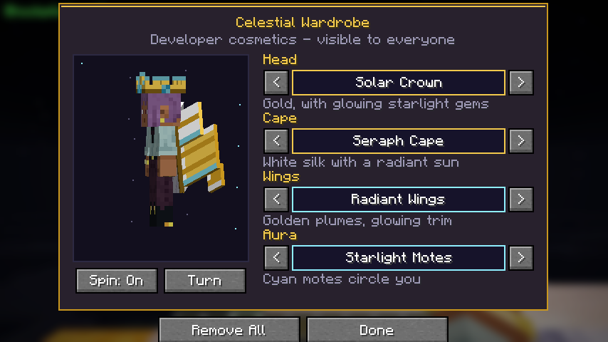
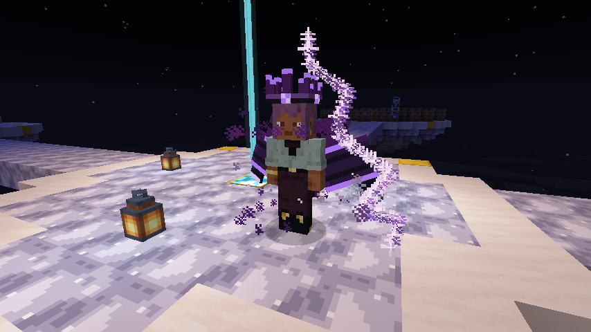

# Astral Vigil

*The Watchers guard the firmament. A rift in the sky rains star fragments upon the world – and the Eclipse awakens.*

A NeoForge mod about starlight, celestial alignments, light beams, constellations, living gear and a floating
Firmament dimension, guarded by four Watchers – and their fallen fifth sibling, the Eclipse.

| Minecraft | Loader | Java | Required | Status |
|---|---|---|---|---|
| 1.21.1 | NeoForge 21.1.266+ | 21 | GeckoLib 4.9+ | feature complete, pre-release |
| 26.1.2 | NeoForge 26.1.2.126+ | 25 | GeckoLib 5.5+ | feature complete, pre-release |

[Deutsch weiter unten](#deutsch) · [Roadmap](docs/ROADMAP.md) · [Changelog](docs/CHANGELOG.md) ·
[Balance](docs/BALANCE.md) · [Design decisions](docs/DECISIONS.md)



## The journey

1. **Starfall.** On clear nights, fragments of the sky crash into the world. Mine the Fallen Star for Astral Shards and
   craft an **Astrolabe** – it reads the sky, the moon phase and the starlight where you stand.
2. **Research.** Study blocks of the four alignments – *Sol*, *Luna*, *Stella* and *Void* – and solve constellations
   on the **Star Chart**. The **Codex Caelestis** (Patchouli, optional) records what you learn.
3. **Starlight.** Collectors gather light under the open night sky. Guide it with Lenses and Mirrors, split it into
   Sol, Luna and Stella with a Prism, and store it in Reservoirs.
4. **Convergence.** Rituals at the **Convergence Altar** and the **Astral Forge** turn offerings and starlight into
   Starmetal, Sunsteel and Moonsilver. Symmetric pedestals and aligned blocks keep a ritual stable.
5. **Living gear.** Halo Edge, Dawnbreaker, Crescent, Tidecaller, Starlight Aegis and Seraph Plate awaken through
   deeds, take socketed **Sigils** and unleash abilities (keys V / B) that cost starlight. Top tier ≈ Netherite.
6. **The world.** Explore **Fallen Observatories**, unlock their Constellation Locks, gather the 24 pages of the
   Lost Chronicle and hold **Star Anchor** rituals – but beware the growing **Eclipse Gaze**.
7. **The Firmament.** Forge the **Ascension Key** and rise above the clouds: low gravity, floating islands and the
   sanctums of Solenne, Vael, Orrin and Ilyra. Pass their trials – a climb, a hunt, a puzzle of light and a library
   maze – to earn their **Marks** and favour.
8. **The Eclipse.** With all four Marks, an **Umbral Sigil** calls down the fallen Watcher: a three-phase boss fight.
   Its heart becomes the **Halo of Dawn**; its feathers bind **Seraph Wings** to you.

| | |
|---|---|
|  |  |
|  |  |
|  |  |
|  |  |

More screenshots: [`docs/screenshots/suite/`](docs/screenshots/suite/).

**Developer cosmetics.** Members of the Astral Vigil team open the *Celestial Wardrobe* with **J**: crowns, a floating
halo, capes, glowing wings and particle auras (including a lightning storm), visible to every player. Server owners
can grant them to staff via `[cosmetics] developers` or switch them off with `[cosmetics] enabled = false`.

## Compatibility

Optional integrations, none required: **JEI** and **EMI** (ritual recipes), **Jade** (starlight, rituals),
**Patchouli** (Codex Caelestis), **KubeJS**/datapacks (all recipes are data-driven with
`c:` and `astralvigil:` tag inputs). Runs alongside Sodium, Iris, Curios and the Apotheosis family (dev compat instance); designed for
All the Mods 10 (1.21.1) and All the Mods 11 (26.1) – the full-pack smoke test is still pending.

## Configuration

- `astralvigil-server.toml` – every balance value: starfall, astrolabe, research, starlight network, crafting,
  gear, Eclipse Gaze, rituals and the Eclipse fight. Reasoning in [docs/BALANCE.md](docs/BALANCE.md).
- `astralvigil-client.toml` – particles, screen shake, beam quality.
- Worldgen is a datapack: override `data/astralvigil/worldgen/structure_set/fallen_observatory.json` to retune or
  disable observatories.
- Admin commands: `/astralvigil starfall [here]`, `/astralvigil research <alignment> <points>|reset`,
  `/astralvigil starlight <pos> <tint> <amount>`.

## Building

Requires Temurin JDK 21 and 25. One codebase for both versions (Stonecutter + ModDevGradle).

```powershell
.\gradlew.bat build               # both targets + unit tests
.\gradlew.bat runGameTestServer   # all GameTests, both targets
.\gradlew.bat runData             # regenerate models, lang, recipes, loot, advancements, codex
```

Jars: `versions/<target>/build/libs/`. Contributor notes: [CLAUDE.md](CLAUDE.md).

## License

All Rights Reserved for now – the final license is pending.

---

## Deutsch

*Die Wächter hüten das Firmament. Ein Riss im Himmel lässt Sternensplitter auf die Welt regnen – und die Finsternis
erwacht.*

Ein NeoForge-Mod über Sternenlicht, himmlische Ausrichtungen, Lichtstrahlen, Sternbilder, erwachende Ausrüstung und
die schwebende Dimension des Firmaments, behütet von vier Wächtern – und ihrem gefallenen fünften Geschwister, der
Finsternis. Unterstützt Minecraft 1.21.1 (NeoForge 21.1, GeckoLib 4) und 26.1.2 (NeoForge 26.1.2, GeckoLib 5),
vollständig auf Deutsch spielbar.

### Die Reise

1. **Sternenfall.** In klaren Nächten stürzen Splitter des Himmels in die Welt. Baue den Gefallenen Stern ab, gewinne
   Astralsplitter und fertige ein **Astrolabium** – es liest Himmel, Mondphase und Sternenlicht an deinem Standort.
2. **Forschung.** Studiere Blöcke der vier Ausrichtungen – *Sol*, *Luna*, *Stella* und *Leere* – und löse Sternbilder
   auf der **Sternkarte**. Der **Codex Caelestis** (Patchouli, optional) hält dein Wissen fest.
3. **Sternenlicht.** Sternenlichtsammler sammeln Licht unter offenem Nachthimmel. Lenke es mit Linsen und Spiegeln, spalte es
   mit einem Prisma in Sol, Luna und Stella und bewahre es in Sternenlichtspeichern.
4. **Konvergenz.** Rituale am **Konvergenzaltar** und in der **Astralschmiede** verwandeln Gaben und Sternenlicht in
   Sternenstahl, Sonnenstahl und Mondsilber. Symmetrische Sockel und ausgerichtete Blöcke halten ein Ritual stabil.
5. **Lebendige Ausrüstung.** Halo Edge, Dawnbreaker, Crescent, Tidecaller, Sternenlicht-Ägis und die
   Seraphenrüstung erwachen durch Taten, nehmen **Siegel** auf und entfesseln Fähigkeiten (Tasten V / B), die
   Sternenlicht kosten. Höchste Stufe ≈ Netherit.
6. **Die Welt.** Erkunde **Gefallene Observatorien**, öffne ihre Sternbildschlösser, sammle die 24 Chronikfragmente der
   Verlorenen Chronik und halte **Sternenanker**-Rituale ab – doch hüte dich vor dem wachsenden **Blick der
   Finsternis**.
7. **Das Firmament.** Schmiede den **Aufstiegsschlüssel** und steige über die Wolken: geringe Schwerkraft, schwebende
   Inseln und die Heiligtümer von Solenne, Vael, Orrin und Ilyra. Bestehe ihre Prüfungen – einen Aufstieg, eine Jagd,
   ein Rätsel aus Licht und ein Bibliothekslabyrinth –, um ihre **Zeichen** und ihre Gunst zu erlangen.
8. **Die Finsternis.** Mit allen vier Zeichen ruft ein **Umbrales Siegel** den gefallenen Wächter herab: ein Bosskampf
   in drei Phasen. Sein Herz wird zum **Heiligenschein der Morgenröte**, seine Federn binden dir **Seraphsflügel**.

### Kompatibilität und Einstellungen

Optionale Integrationen: JEI, EMI, Jade, Patchouli, KubeJS/Datapacks. Getestet mit Sodium, Iris und
Apotheosis; ausgelegt für All the Mods 10 und 11. Alle Balancewerte stehen in `astralvigil-server.toml`, Partikel,
Bildschirmwackeln und Strahlqualität in `astralvigil-client.toml`.

### Lizenz

Vorerst alle Rechte vorbehalten – die endgültige Lizenz steht noch aus.
